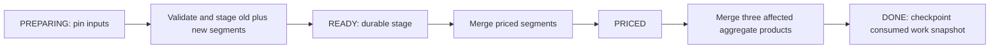

# Bounded Gold refresh and recovery

Gold consumes the Silver endpoint ledger from [bounded Silver](bounded-silver.md). Each new Gold run captures the interval, four reference and Silver work snapshots. The first run bootstraps a complete destination. Subsequent bounded runs select DONE endpoint records absent from the previously consumed work snapshot, across **all** intervening Silver batches. Multiple changed endpoints are deduplicated by `(meter_id, interval_end)`.

The previous endpoint can disappear after an installation baseline. The selection therefore includes old priced rows even when the current Silver endpoint is absent. The priced segment key is `(meter_id, interval_end, segment_start, segment_end)`. Obsolete keys are deleted, surviving keys updated only when values differ, and new keys inserted. Every new segment uses the existing Decimal tariff calculator, UTC boundaries, Europe/Paris dates and half-even 12-decimal persistence.

## Durable stages

`priced_intervals_refresh` records one immutable Gold run identifier, generation, requested mode, pinned snapshots and state. `priced_intervals_stage` stores OLD and NEW segments for that run, including both old and new customer/site/date footprints. Both are Iceberg tables in the existing project database and warehouse.



PREPARING can discard and recreate a partial stage, using the captured snapshots. It never changes Gold products. A caught preparation error rechecks persisted state and removes the failed attempt only if still PREPARING, allowing corrected inputs to be captured on the next attempt. If READY committed despite a lost response, the stage is retained. A hard process death retains PREPARING for a retry. READY retries reuse the durable stage, even if the priced commit already happened. PRICED retries recompute and merge each affected aggregate group from the complete current priced table. The three products have separate atomic commits. DONE is written only after all three succeed. Any group with no remaining valid priced rows receives a delete tombstone. Recomputing the entire affected group retains contributions from unaffected meters sharing it.

Only one pending Gold run is accepted. A different run is refused until that run finishes. Retrying requires the same `BATCH_ID`, `REFRESH_MODE`, and complete source/destination table mapping, which is pinned in the checkpoint. Both jobs receive that mapping. Retrying a completed identifier returns without changing targets. A new identifier with no new Silver endpoints skips target mutations and preserves all four product snapshot IDs. Stage and checkpoint records remain until demonstration cleanup, except discarded failed PREPARING attempts.

## Operation

Pause reference and Silver writers throughout the **entire** Gold chain. Run one writer across all job definitions and direct table operations; the per-job Glue concurrency limit does not implement a distributed chain lock. Finish Silver first, including any PENDING recovery. Readers should publish/use products only once the chain succeeds, because a partially completed chain is visible per table.

```bash
.venv/bin/python scripts/run_gold_jobs.py --pricing-job DEMO_GOLD_PRICE_JOB --aggregate-job DEMO_GOLD_AGGREGATE_JOB --database demo_database --batch-id gold-initial --dry-run
.venv/bin/python scripts/run_gold_jobs.py --pricing-job DEMO_GOLD_PRICE_JOB --aggregate-job DEMO_GOLD_AGGREGATE_JOB --database demo_database --batch-id gold-initial --profile PROJECT_OPERATOR_PROFILE
.venv/bin/python scripts/run_gold_jobs.py --pricing-job DEMO_GOLD_PRICE_JOB --aggregate-job DEMO_GOLD_AGGREGATE_JOB --database demo_database --batch-id gold-next --profile PROJECT_OPERATOR_PROFILE
```

Gold run identifiers identify a consumption checkpoint, not a single Silver batch. Never reuse a DONE identifier for new input. Inspect any timed-out AWS run before retrying, then reuse the interrupted run identifier and mode. To run just the aggregate job during recovery, pass the same run identifier, mode and all source/destination table arguments from the launcher's dry run.

## Reference changes and migration

If any reference snapshot differs from the last DONE checkpoint, bounded mode refuses before publishing or recording a new run. Snapshot equality is deliberately conservative: even a semantically identical reference rewrite requires a full run. Use a new identifier with `--refresh-mode full`. Full mode stages all old and newly priced segments and recomputes the union of their aggregate footprints, removing groups left behind by ownership, tariff or validity changes. An empty input can clear the destination.

This version refuses a pre-existing priced table without a checkpoint. Migrate the previous full-rebuild implementation into a **fresh destination database/table set**, bootstrap it, reconcile the complete products, then switch readers after success. Do not delete checkpoints as a reset mechanism. Expired or missing captured snapshots fail closed; retain referenced interval/reference/work snapshots and ledger rows for recovery and the next bounded run. No automatic retention or snapshot expiration policy is added.

## Deployment and bounds

Terraform ships the new `gold_refresh.py` module to both existing Glue jobs. The operator policy adds only that named module path; no warehouse write permission or wider catalog scope is added. The exact new S3 object address joins the tag-checked cleanup allowlist. The existing database/bucket teardown removes checkpoints and stages. Deploy these source changes together before relying on scheduled cleanup from `main`.

The bound covers selected endpoint pricing and target row/group mutations. Work-ledger comparison, priced target matching and affected-group recomputation can still scan broad histories. Iceberg copy-on-write can rewrite files containing unchanged rows. There is no physical scan, file-count, latency or cost proportionality claim, no benchmark and no multi-table transaction. Reference-impact planning remains a full explicit refresh.

## Verification

The local suite checks argument boundaries, source snapshot failures, retry identities and pending-run exclusion, alongside existing tariff, DST, temporal ownership and replay tests. `tests/glue/qualify_bounded_gold.py` is the native Glue 5/Iceberg qualification driver. It creates only `qualification_gold_*` tables inside a caller-provisioned disposable project database and calls the exact production module. Run it using the existing price job's [per-run script override](https://docs.aws.amazon.com/glue/latest/dg/aws-glue-programming-etl-glue-arguments.html), `--DATABASE`, and the deployed shared modules. It is intentionally not part of local unittest discovery.

The driver reconciles every priced segment and every group/measure with the shared full calculator, exercises two Silver commits before Gold, a late split at a local month boundary, an absent baseline endpoint, failures after the priced commit and first aggregate commit, blocked concurrent run identity, changed destination rejection, pending Silver rejection, no-op target snapshots, explicit full ownership refresh and failed preparation with corrected-input recovery. It simulates driver interruptions around actual commits; it does not inject a managed-service outage or IAM denial. Provisioning, launch, private log review and guarded teardown remain caller responsibilities.

### Managed qualification on 2026-11-03

The final driver succeeded on Glue 5/Iceberg with two G.1X workers. Its six reconciliations compared all priced segments and all three complete aggregate products: 102 initial segments, 102 after the month-boundary correction/recovery, then 100 after endpoint deletion and through replay, explicit ownership refresh and corrected-input recovery. Both injected interruptions recovered, changed destinations and pending Silver were refused, and invalid preparation left all target snapshots unchanged and released its unpublished checkpoint.

The actual deployed pricing and aggregate job scripts also succeeded sequentially. Athena independently confirmed unchanged target snapshots on that no-op run and exactly two OLD plus two NEW correction segments in the durable stage, with zero segments from the unaffected meter. All five deployed production files matched the checkout byte for byte. The driver, pricing entry point and aggregation entry point took 317, 100 and 58 execution seconds respectively. These are service execution durations for a small synthetic fixture, not performance scaling results.

Reviewed results, source hashes and guarded cleanup verification are in [the sanitized evidence](evidence/bounded-gold-2026-11-03.json). Raw logs, job identifiers, deployment outputs and Terraform plans remain in ignored local artifacts.
