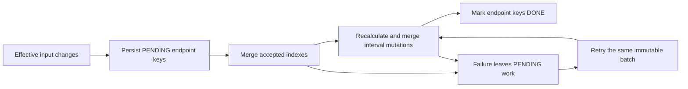

# Bounded Silver interval recalculation

## Scope and measured units

The index job applies new business keys and strictly higher `source_version` values. Only an effective changed reading and its immediate successor in the merged sequence can change an interval. Overlapping endpoints from multiple changes are deduplicated. An unchanged or lower-version replay produces no interval work.

The bound concerns logical interval pairs and mutations. Neighbour lookup still reads/sorts the affected meters' index history, and Iceberg copy-on-write may rewrite files containing unchanged rows. This implementation does not claim bounded physical reads, proportional latency improvements or bounded file rewrites. [Gold now bounds endpoint pricing and affected-group mutations](bounded-gold.md); reference-history impact planning remains an explicit full refresh.

## Recovery protocol

The job requires the immutable `BATCH_ID` already supplied by `scripts/run_silver_index_job.py`. It derives its work table by appending `_recalculation_work` to `SILVER_INTERVAL_TABLE`. For example, `meter_consumption_interval_recalculation_work` contains:

| Column | Type | Meaning |
| --- | --- | --- |
| batch_id | string | Immutable source batch identifier and partition |
| meter_id | string | Meter owning the affected endpoint |
| reading_at | timestamp | Interval end to refresh, including possible tombstones |
| state | string | `PENDING` or `DONE` for Silver processing |



Each table commit is atomic through Iceberg; the complete sequence is not a multi-table transaction. Work is persisted before index changes. If an interval commit fails after indexes have advanced, retrying the same batch still processes the saved pending endpoints even when there are zero new index updates. If the index commit failed, the same source is merged again before interval work resumes. If completion marking fails, the retry compares intervals and avoids already applied mutations.

A different batch is refused while pending work exists. Run one writer across the table set, including external job definitions, and finish/retry Silver successfully before running Gold. The Glue definition allows one concurrent run; client launchers also use native Glue queuing. `DONE` means Silver intervals are synchronized, not that Gold has consumed the batch. Work records are retained until demo cleanup; no automatic ledger retention policy is introduced.

## Data behavior

Incoming duplicates use highest version and then latest receipt time within the batch. Across batches, equal/lower versions are ignored. UTC session time is explicit. Table names must be distinct simple `glue_catalog.database.table` identifiers, and batch IDs must follow the existing lowercase landing naming rule.

A corrected installation baseline removes its obsolete interval. First readings also produce no interval. Successors are recalculated from the new preceding reading. Actual writes compare every interval field, so an unchanged successor does not need an interval mutation. Declared rollover arithmetic includes every declared rollover.

The projected changed pairs are validated before staging work or changing accepted indexes. An unexplained regression, inconsistent rollover declaration or correction that breaks its successor rejects the batch at this boundary. The caller can submit a corrected higher-version record in a new immutable batch because no pending work was staged. Automatic per-row sequence quarantine is not implemented here; keeping a regressed reading as an accepted predecessor could otherwise produce a misleading valid successor. Existing defensive pair-level quality statuses remain distinct from raw value/contract quarantine.

Negative/out-of-range registers, invalid versions, unsupported schema versions, invalid rollover values, missing receipt timestamps and null/unsupported contexts are excluded from accepted index updates. Their quarantine merge is idempotent, including null versions. A quarantined correction does not overwrite the previously accepted index. This is not a complete JSON schema validator: malformed or missing whole columns can fail input parsing before row-level quarantine.

## Execution and audit

The existing runner accepts `--dry-run` to validate/display arguments offline. Use `--wait` for bounded polling and a nonzero result on failure/expiry/timeout. The default client wait is one hour; a client timeout leaves the managed run active and requires inspecting it before retrying. A failed batch must reuse its original immutable source and batch ID.

Generate fresh deterministic qualification inputs without contacting AWS:

```bash
.venv/bin/python scripts/generate_bounded_silver_fixture.py --output-dir artifacts/bounded-silver-fixture
```

The initial fixture has two meters with 1,000 readings each. Other folders contain appends, a late reading/correction, a baseline, invalid records and the inputs for controlled recovery/sequence-rejection checks. Each folder has an immutable-uploader-compatible hash manifest. The generator refuses to overwrite an existing fixture. Fault injection is a qualification operation on a disposable environment, not a job runtime option.

Each successful job prints one JSON audit record with `changed_indexes`, `recalculated_interval_keys` and `interval_mutations`. For a fresh single correction, at most two logical keys are recalculated. A recovery may report zero changed indexes and nonzero interval work. An unchanged replay reports zero for all three counters and does not commit index, interval or work snapshots.

The new work table is created by the existing Glue execution role inside the demo database. No extra Terraform resource, S3 script object or IAM grant is required. Database/bucket cleanup removes work data, while the existing guarded identity protections remain in place. Deploy the updated script object through Terraform before testing; preserve complete batch history for an independent full-rebuild comparison.

## Verification

The local oracle in `recalculation.py` plans endpoints independently of the Spark window implementation. Tests apply those pairs and compare all interval content to full derivation, including randomized valid corrections, late inserts, first/last readings, adjacent changes, baseline tombstones, multiple rollovers, replay and unchanged meters. Commit-protocol tests inject an interval failure and verify that pending work is not marked done and is processed when retrying zero-change input.

## Managed AWS qualification on 2 November 2026

The [reviewed evidence](evidence/bounded-silver-2026-11-02.json) records a disposable `eu-west-3` environment. Every successful snapshot was compared interval by interval to full local business derivation. The public fixture reproduces the uploaded data rows byte for byte.

| Scenario | Effective index changes | Interval keys recalculated | Interval mutations |
| --- | ---: | ---: | ---: |
| Initial 2,000 readings | 2,000 | 2,000 | 1,998 |
| Append two readings | 2 | 2 | 2 |
| Correction + late reading | 2 | 3 | 3 |
| Retry after denied interval commit | 0 | 2 | 2 |
| Correct a reading to a baseline | 1 | 2 | 1 deletion |
| Two value/contract-invalid readings | 0 | 0 | 0 |
| Replay initial batch after corrections | 0 | 0 | 0 |

A temporary explicit deny on the disposable Glue role forced the interval metadata commit to fail after index changes had committed. Two pending keys remained. A different batch was rejected, and retrying the original source completed both keys despite zero effective index changes. The temporary policy was removed immediately after the injected failure and verified absent before cleanup.

The final accepted state had 2,003 indexes, 2,000 intervals, two quarantine records and zero pending work. Replay preserved the index, interval and work-table snapshot IDs. A separate contradictory correction failed before accepted writes and preserved all three snapshot IDs as well. Seven managed runs succeeded; three runs failed for the deliberate commit/foreign-batch/sequence tests. One idle queued submission was stopped after the service reported a concurrency limit while every other run was terminal, then the same source was resubmitted. No concurrency limit was raised.

Guarded CodeBuild cleanup removed the demo data plane and the work table with its database/bucket. Direct checks confirmed persistent identities and versioned state remained. The project's original scheduled-cleanup state was restored. Raw source data, plans, account details and logs remain private in ignored artifacts; only reviewed counters, hashes, flags and the cleanup revision are published.
