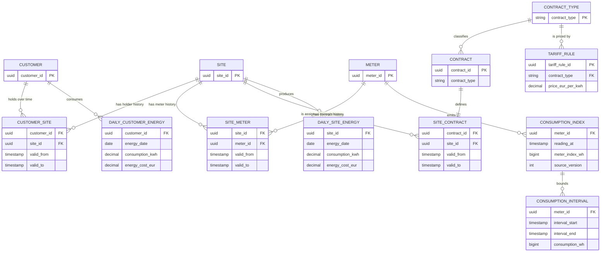
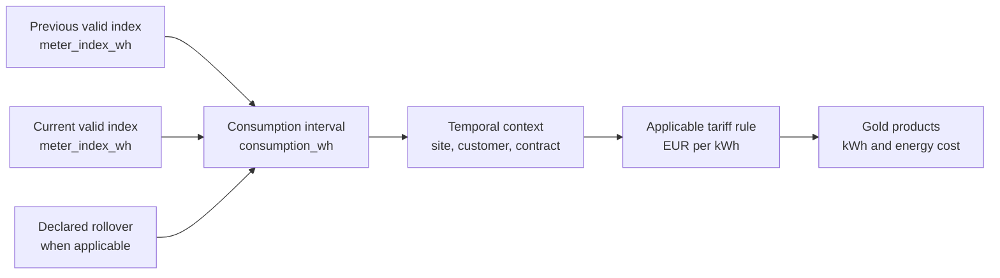

# Data relationships

## Business entities and temporal relationships

`CUSTOMER_SITE`, `SITE_METER`, and `SITE_CONTRACT` are temporal relationship flows. They preserve history through `[valid_from, valid_to)` intervals rather than overwriting prior state.

At a given instant, a site has zero or one active primary holder, exactly one active meter, and exactly one active contract. Over time, a customer can hold many sites and a site can be associated with many historical holders, meters, or contracts.

## Consumption derivation and allocation

An installation baseline index begins a new meter history but produces no consumption. A correction or late index can change the adjacent intervals and only the corresponding gold products are recalculated.
