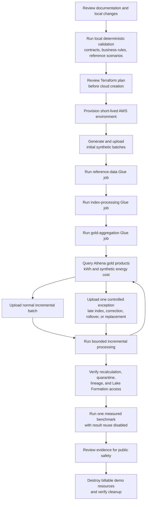
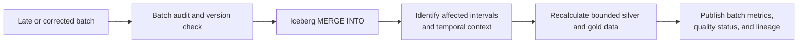

# Demonstration workflow

## Local-first validation and controlled AWS demonstration

The demonstration is deliberately staged. Local correctness is proven before AWS use. The cloud segment demonstrates one initial load, one normal incremental batch, and one exception path before a controlled benchmark and destruction.

## Exception path

An unchanged replay stops at the version check. A higher source version or a newly arrived historical index follows the recalculation path.
