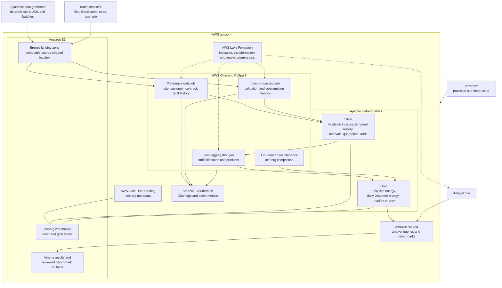
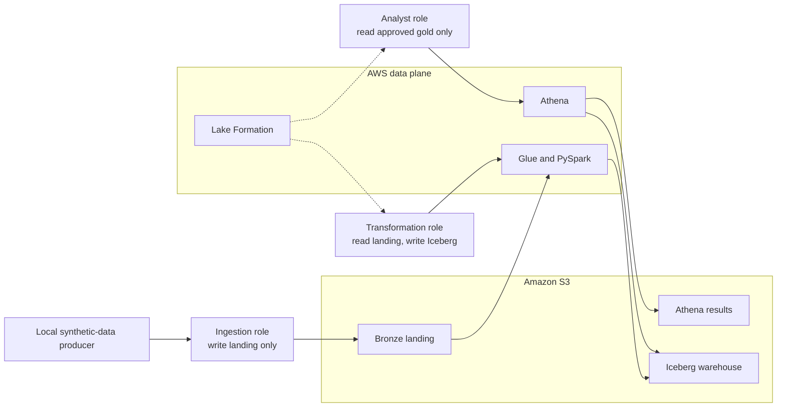

# V1 Architecture

## Data platform and processing flow

The diagram describes the intended V1 deployment. The generator is local and produces only synthetic data. Bronze retains immutable landing batches, silver holds validated operational state, and gold exposes analyst-ready products through Athena.

## Access and operational boundaries

The analyst does not read landing files or operational silver tables. No static AWS credentials, account identifiers, or real data belong in the repository or rendered evidence.
